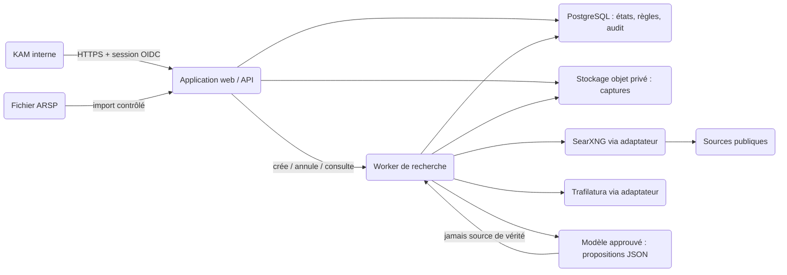

# Architecture Blueprint — Onbora Company Research Agent

**Portée :** prototype interne contrôlé de 1 à 3 recherches unitaires, à partir de la base ARSP.

**Sources examinées :** le brief de découverte, le PRD et le fichier `liste_entreprises_arsp.xlsx`. Cette architecture ne modifie pas les règles métier normatives du PRD ; elle les rend applicables et auditables.

<!-- architecture-section: executive-verdict -->
## Executive Verdict

- **Recommendation:** construire un **monolithe modulaire interne** : une application web et API Django, un processus worker du même code, PostgreSQL pour les données structurées et l’audit, et un stockage objet privé pour les captures de preuve minimales. SearXNG et Trafilatura restent des adaptateurs remplaçables. Un modèle de langage, s’il est approuvé, ne peut produire que des propositions structurées à partir de preuves déjà conservées ; les statuts d’identité, de fait et de contradiction restent calculés par un moteur déterministe versionné.
- **Why this fits:** le MVP traite une entreprise à la fois, impose une revue humaine et doit prouver la provenance plutôt que la vitesse ou le volume. Cette solution assure exécution asynchrone, reprise, annulation, idempotence et traçabilité sans ajouter de microservices, de bus d’événements ou de base spécialisée.
- **Main risk:** une source publique peut être attribuée à la mauvaise entreprise. Une fiche fluide mais erronée serait plus dommageable qu’une fiche pauvre ; la résolution d’identité conservatrice et la revue humaine sont donc le chemin critique.
- **Decide now:** adopter le modèle « preuve d’abord », le moteur de règles déterministe et le stockage minimal nécessaire aux trois cas. Avant toute exécution utilisant un modèle externe, Onbora doit aussi approuver le fournisseur et les conditions de traitement des extraits transmis.
- **Can wait:** fournisseur cloud précis, moteur de recherche payant, connecteurs sociaux authentifiés, traitement batch, CRM, files de messages managées, cache, microservices et multi-région.
- **Confidence:** moyenne à élevée pour le prototype. Les contraintes de produit et la qualité de la source ARSP sont documentées ; la couverture réelle du web, l’utilité KAM et la politique de conservation au-delà du test restent à démontrer.

<!-- architecture-section: project-frame -->
## Project Frame

### Goals

- Permettre à un KAM interne de sélectionner une ligne ARSP et de déclencher une recherche publique unitaire.
- Produire une fiche courte, versionnée et vérifiable : identité, faits, contradictions, limites, sources et décision de revue.
- Conserver la preuve avant toute interprétation et empêcher tout fait important non sourcé.
- Rendre les cas `ambiguous`, `not_found`, `partial`, une erreur ou une annulation aussi explicites qu’un résultat positif.
- Mesurer la qualité du protocole sur trois profils de visibilité avant tout élargissement.

### Non-goals

- Batch de la base ARSP, scoring commercial, recommandations Orange, CRM, outreach, surveillance continue ou contact d’une entreprise.
- Connexion à des réseaux sociaux, contournement de paywall, de CAPTCHA, d’anti-bot ou d’authentification.
- Recherche, affichage ou enrichissement de données personnelles sur dirigeants et salariés.
- Certification légale, KYC, due diligence réglementaire ou décision commerciale automatique.

### Constraints

- Le `Numéro Dossier` est la clé de la ligne source pour le prototype. Le RCCM est un attribut de rapprochement, jamais une clé unique.
- Le prototype est interne, en français, et chaque fiche doit être revue humainement avant d’être considérée comme validée.
- Les preuves, journaux et synthèses doivent rester séparés ; une correction ou réexécution crée une version, elle ne réécrit pas l’historique.
- Le PRD fixe un accusé de lancement inférieur à 2 s, une première progression sous 5 s et une cible provisoire de résultat ou fiche partielle en moins de 10 min dans 90 % des cas.

<!-- architecture-section: evidence-and-assumptions -->
## Evidence, Assumptions, and Unknowns

| Item | Type | Confidence | Impact if wrong | Validation |
|---|---|---:|---|---|
| Le classeur ARSP a une feuille `Données`, 11 colonnes de seed et 11 991 lignes de données. | Fait vérifié | Élevée | Moyen | Lecture du classeur le 13 septembre 2026. |
| `Numéro Dossier` est renseigné et unique sur les 11 991 lignes observées. | Fait vérifié | Élevée | Élevé | Contrôle d’unicité à chaque import. |
| Après normalisation des espaces et de la casse, 101 groupes de RCCM dupliqués couvrent 208 lignes. | Fait vérifié | Élevée | Élevé | Test de normalisation reproductible à chaque import. |
| Les statuts d’identité, de faits et de revue du PRD sont la source normative du comportement. | Décision produit | Élevée | Élevé | Tests de règles à partir des critères d’acceptation FR-007 à FR-014. |
| Une exécution unitaire, avec une seule recherche active identique, est suffisante pour les trois premiers cas. | Hypothèse | Moyenne | Moyen | MET-005 et MET-007 après les trois exécutions. |
| SearXNG et Trafilatura couvrent suffisamment les sources publiques sans authentification. | Hypothèse technique | Moyenne | Moyen | MET-006, MET-007 et comparaison avec la recherche manuelle KAM. |
| Une synthèse assistée par modèle peut être autorisée et son fournisseur est acceptable. | Inconnu / décision d’autorité | Faible | Élevé | Approbation Product/Data/Legal et test de minimisation des données avant appel réel. |
| La durée de conservation, les exceptions d’audit et la procédure de suppression au-delà des trois cas sont définies. | Inconnu | — | Élevé | Décision DEC-006 avant pilote élargi. |
| Le KAM pilote et les trois entreprises représentatives sont désignés. | Inconnu | — | Moyen | Précondition de lancement du test. |

<!-- architecture-section: critical-flows -->
## Critical Flows

1. **Création idempotente d’une recherche :** un KAM authentifié sélectionne une ligne ARSP → l’API vérifie son rôle → lit la ligne par `Numéro Dossier` → fige le seed brut et les variantes normalisées → calcule une empreinte de demande → crée une exécution `queued` dans une transaction, ou renvoie l’exécution identique déjà active → écrit l’événement d’audit → répond immédiatement avec l’identifiant de run. Un utilisateur non autorisé reçoit une réponse qui ne confirme pas l’existence de la ligne ou d’une recherche.
2. **Collecte de preuve :** le worker revendique un run avec un bail → le planificateur construit les requêtes autorisées → l’adaptateur de recherche renvoie des URLs → le récupérateur applique les limites d’accès et de volume → chaque tentative est journalisée → chaque contenu retenu est capturé, haché, extrait et stocké avant toute analyse. Refus d’accès, limite de temps ou source indisponible deviennent des événements et peuvent conduire à une couverture `partial`, jamais à une réussite complète implicite.
3. **Résolution, fiche et revue :** les preuves stockées produisent des candidats et attributs normalisés → le moteur de règles calcule identité, indépendance des sources, faits et contradictions → le synthétiseur peut proposer un texte et des liens de preuve, sans écrire directement en base → le validateur refuse tout fait sans preuve valide → une projection `BriefVersion` passe à `awaiting_review` → le KAM accepte, rejette ou demande une révision. Seule cette dernière action clôt la revue.
4. **Interruption et reprise :** l’opérateur demande l’annulation → le worker vérifie le signal entre étapes et avant chaque collecte → aucune nouvelle requête n’est lancée → les tentatives et captures déjà validées restent attachées au run. Après panne transitoire du worker, un bail expiré peut être repris à partir du dernier jalon durable ; après échec terminal, une nouvelle relance crée un run lié, sans écraser la version antérieure ni recompter une même capture comme source indépendante.

<!-- architecture-section: quality-scenarios -->
## Quality Scenarios

| ID | Context and stimulus | Measurable response | Status | Evidence |
|---|---|---|---|---|
| QS-001 | Une fiche est proposée à revue. | 100 % des faits importants portent au moins un `evidence_id` valide de la même exécution ; aucun fait invalide n’est publié. | Exigence | Contrôle de contrainte et tests FR-006/FR-008 ; MET-003. |
| QS-002 | Un KAM soumet deux fois la même demande active. | Une seule exécution `queued` ou `researching` existe pour l’empreinte de demande ; la seconde réponse ouvre l’exécution existante. | Exigence | Test d’intégration de l’index unique partiel et de la transaction. |
| QS-003 | Une URL demande une connexion, un paywall ou échoue. | La tentative est conservée avec son motif ; aucun contournement n’est tenté et la fiche indique `partial` si une catégorie du protocole manque. | Exigence | Test d’adaptateur avec pages simulées ; FR-005/FR-010/FR-015. |
| QS-004 | Une recherche pilote démarre normalement. | Accusé visible < 2 s, première progression < 5 s ; cible provisoire : 90 % des runs atteignent un terminal explicite ou `awaiting_review` en < 10 min. | Proposé par PRD, non mesuré | Instrumentation de durée par étape ; MET-005. |
| QS-005 | Deux pages plausibles décrivent des entités ou coordonnées incompatibles. | Une contradiction forte force `ambiguous` jusqu’à résolution conforme ; aucune valeur ne remplace silencieusement l’autre. | Exigence | Jeux de tests de règles, cas C et MET-001/MET-004. |
| QS-006 | Un KAM non autorisé ou un acteur externe demande un run, une preuve ou une fiche. | L’API refuse sans révéler contenu ni existence ; la vérification est effectuée côté serveur, sur la ressource demandée. | Exigence | Tests allow/deny et audit de consultation. |
| QS-007 | Le worker redémarre, une source est lente ou une requête est répétée. | Les jalons déjà écrits sont réutilisés, une capture URL+version n’est pas dupliquée et les nouveaux appels restent dans le budget de reprise. | Exigence | Test de bail expiré, de reprise et de déduplication. |
| QS-008 | Une fiche antérieure est consultée après réexécution ou changement de règles. | Elle affiche toujours son seed, ses captures, versions de schéma et règles, journal, revue et résultat originels. | Exigence | Test de relecture de version ; NFR-004 et FR-013. |

<!-- architecture-section: architecture -->
## Architecture

### Context

Les frontières de confiance sont : le navigateur interne vers l’application, l’import ARSP, les URLs et contenus publics, puis l’éventuel fournisseur de modèle. L’application possède les autorisations, PostgreSQL les états et références, et le worker seul possède le droit de sortie vers les sources publiques et le modèle. Aucun fournisseur externe n’accède directement à la base ou au stockage objet.

Le déploiement comprend deux processus du même dépôt et des mêmes modules métier, pas deux systèmes indépendants :

- `web` sert l’interface et l’API ; il ne lance pas de collecte longue.
- `worker` exécute les étapes persistées et réclame les jobs PostgreSQL par bail.
- `postgres` est la source transactionnelle des décisions, liens, journaux et projections.
- `object storage` conserve les captures textuelles minimales et, si nécessaire, le document extrait ; PostgreSQL conserve le manifeste, le hash et les extraits nécessaires à la fiche.

Cette séparation rend la progression et la reprise possibles tout en conservant un seul modèle de domaine et une seule transactionnelle de référence.

### Components and ownership

| Component | Responsibility | Owned data/resources | Inputs/outputs | Allowed dependencies | Failure behavior |
|---|---|---|---|---|---|
| Application web et API | Authentifier, autoriser, importer, créer/consulter/annuler des runs et enregistrer les revues. | Sessions, contrôles RBAC, vues KAM. | HTTP interne ↔ contrats `/api/v1`. | PostgreSQL, stockage via service de preuves. | Réponse d’erreur sûre ; aucune collecte synchrone. |
| Module `arsp` | Importer, valider et normaliser sans modifier la source. | Imports, enregistrements source, rapport de qualité. | XLSX → `ArspRecord` et seed gelé. | Lecteur XLSX, PostgreSQL. | Rejette un import invalide ; ne remplace jamais un import validé. |
| Orchestrateur de runs | Gérer état, idempotence, baux, annulation, jalons et relance liée. | `ResearchRun`, empreinte, bail, événements. | Commandes API → étapes de worker. | PostgreSQL ; services métier internes. | Libère un bail expiré ; marque un échec explicite après budget de reprise. |
| Planificateur et adaptateurs de sources | Construire les requêtes autorisées, chercher, récupérer et extraire du contenu public. | Plans, tentatives, limites par run/domaine. | Seed → résultats, URLs, contenu extrait. | SearXNG, HTTP public, Trafilatura. | `unavailable` ou `partial`, sans contournement ni relance infinie. |
| Service de preuves | Dédupliquer, minimiser, hacher et conserver les captures avant interprétation. | `EvidenceCapture`, manifeste, objet privé, liens de source. | Page extraite → preuve versionnée. | PostgreSQL, stockage objet. | Ne publie pas de fait si la capture échoue ou est invalide. |
| Résolution et moteur de politiques | Évaluer candidats, indépendance, identité, faits et contradictions selon règles versionnées. | Évaluations, `FactClaim`, contradictions, version des règles. | Captures → états normatifs. | PostgreSQL ; normaliseurs purs. | Applique le statut le plus conservateur et expose une limitation. |
| Synthétiseur contrôlé | Proposer une formulation française et des associations fait-preuve, jamais une décision de vérité. | Aucun état de domaine direct. | Paquet de preuves filtrées → JSON conforme au schéma. | Fournisseur de modèle approuvé ou implémentation locale. | Absence/erreur : fiche de preuves structurée sans résumé généré, ou `partial`. |
| Service de fiche et revue | Construire une projection immuable et enregistrer une décision humaine versionnée. | `BriefVersion`, `Review`, audit de lecture/action. | Résultats validés → vue KAM/JSON. | PostgreSQL, service de preuves. | Ne rend pas une fiche non revue « validée ». |
| Observabilité et opérations | Donner les métriques, logs sûrs, traces, alertes et procédures de reprise. | Événements techniques agrégés, tableaux de bord. | Événements de run → métriques/alertes. | Application, worker, plateforme. | Ne journalise ni secrets, ni extraits, ni requêtes complètes. |

<!-- architecture-section: data-and-contracts -->
## Data and Contracts

### Source of truth and lifecycle

- **ARSP :** le classeur original demeure la source de l’import. Un `ArspImport` stocke son hash, son schéma, la date et le rapport de validation. `ArspRecord` représente la version importée de la ligne ; `Numéro Dossier` est unique dans cette version, mais une demande fige toujours son propre snapshot JSON brut.
- **Preuve :** `EvidenceCapture` est la source de vérité de la provenance : URL canonique, URL observée, titre, éditeur, type, relation, états d’accès, dates, hash de contenu, extrait minimal et pointeur vers l’objet privé. Une même URL avec un contenu différent crée une nouvelle capture ; une même URL et même hash est réutilisée via une table de liaison au run.
- **Décision dérivée :** les candidats, évaluations d’identité, faits et contradictions dépendent de captures explicitement liées. Ils stockent `rules_version` et ne deviennent pas une vérité globale sur l’entreprise.
- **Présentation :** `BriefVersion` est une projection immuable, avec `schema_version`, seed, règles, captures et revue de référence. La fiche n’est jamais la seule copie d’un fait ou d’une preuve.

### Core entities and integrity rules

| Entity | Invariants and main fields |
|---|---|
| `ArspImport` / `ArspRecord` | Hash du fichier, version d’import, valeurs brutes, variantes normalisées et avertissements. L’import échoue si `Numéro Dossier` ou dénomination est absent ; les collisions sont signalées. |
| `ResearchRun` | ULID, `source_record_id`, snapshot, `request_fingerprint`, état, couverture, protocole, règles, demandeur, bail et lien éventuel vers `previous_run_id`. Un index unique partiel interdit deux runs identiques `queued` ou `researching`. |
| `ResearchEvent` / `SourceAttempt` | Append-only : transition, étape, requête autorisée, catégorie, URL, résultat, motif et horodatage. Les logs d’infrastructure ne recopient pas ce contenu. |
| `EvidenceCapture` / `RunEvidence` | Capture immuable et relation au run. Unicité sur URL canonique + hash de contenu. Le groupe d’indépendance est calculé à partir du domaine/publisher, jamais du nombre brut de liens. |
| `EntityCandidate` / `IdentityAssessment` | Attributs normalisés, preuves de support, statut unique le plus conservateur et raison calculée. Une contradiction forte ouverte force `ambiguous`. |
| `FactClaim` / `FactEvidence` / `Contradiction` | Valeur canonique, champ, date, statut, liens de preuves et span/attribut support. Un fait ne passe le validateur que si la valeur est soutenue par une capture ; deux valeurs incompatibles restent visibles. |
| `BriefVersion` / `Review` / `AuditEvent` | Projection, auteur, date, utilité, motif et version. Une révision ou suppression autorisée ajoute un événement et une version, sans mise à jour destructive du passé pendant la conservation applicable. |

Les opérations longues ne sont pas transactionnelles de bout en bout. Chaque étape durable — création de run, tentative, capture, évaluation, projection ou revue — est une transaction courte. Le worker ne passe à l’étape suivante qu’après validation du jalon précédent.

### State model

`ResearchRun.state` suit strictement : `queued → researching → awaiting_review → reviewed`, ou `queued/researching → failed | cancelled`. La couverture est une dimension distincte : `complete | partial`. Les statuts d’identité, de fait et de revue suivent les vocabulaires du PRD et ne sont pas dérivés d’un simple succès technique.

Une reprise après un arrêt de processus utilise le même run seulement si le bail du worker a expiré et que le jalon est idempotent. Une nouvelle tentative après `failed` ou `cancelled` crée un autre `ResearchRun` lié à l’original. La règle de déduplication de preuve (`canonical_url`, `content_hash`) empêche de transformer une reprise en fausse corroboration.

### Internal API contracts

| Interface | Contrat et règles |
|---|---|
| `POST /api/v1/research-runs` | Entrée : `source_record_id`, options de protocole autorisées et éventuellement clé d’idempotence. Le serveur lit le seed, crée ou renvoie le run actif identique. Réponse `201` ou `200` avec `run_id`, état et liens. |
| `GET /api/v1/research-runs/{run_id}` | Vue de progression, couverture, limites et liens vers la fiche. Les détails de preuve restent filtrés par rôle. |
| `GET /api/v1/research-runs/{run_id}/brief?version=` | Représentation JSON versionnée et vue KAM dérivée de la même projection. Aucun champ affiché ne contourne le validateur de provenance. |
| `POST /api/v1/research-runs/{run_id}/cancel` | Opérateur uniquement ; écriture d’un signal d’annulation. Le worker confirme l’arrêt au prochain jalon sûr. |
| `POST /api/v1/briefs/{brief_id}/review` | KAM relecteur ou opérateur ; entrée validée : décision, utilité, motifs requis pour rejet, note courte. Une décision est versionnée et auditée. |
| Interface `SearchProvider` | `search(query, limits) → SearchResult[]`. SearXNG est une implémentation initiale, pas une dépendance métier. |
| Interfaces `ContentFetcher` et `Extractor` | URL prévalidée → résultat d’accès borné → texte/métadonnées/capture. Toute implémentation doit respecter timeout, taille, redirections et refus d’accès. |
| Interface `SynthesisProvider` | Paquet minimal de preuves admises → propositions JSON qui référencent uniquement les `evidence_id` fournis. L’interface ne reçoit ni accès base, ni secrets, ni droits d’écriture. |

Les contrats HTTP internes sont versionnés en `/v1`, validés par schéma et limités en taille. Les erreurs sont stables : `validation_failed`, `not_found_or_forbidden`, `conflict_active_run`, `invalid_state` et `source_not_allowed`. Une erreur technique détaillée reste dans le journal opérateur, jamais dans la réponse KAM.

<!-- architecture-section: trust-and-security -->
## Trust and Security

- **Identity and authorization:** l’application applique OIDC d’entreprise lorsqu’il existe ; des comptes internes administrés sont tolérés uniquement pour le test. Elle résout le rôle côté serveur (`kam`, `reviewer`, `operator`, `admin`) et vérifie chaque `run_id` ou `brief_id` dans le service propriétaire. L’UI ne constitue jamais une autorisation. Toutes les consultations de fiche/preuve et décisions de revue sont auditées.
- **Data classification and lifecycle:** le seed ARSP est interne et peut contenir coordonnées ambiguës ; les captures sont publiques à la source mais internes une fois collectées ; les reviews et journaux sont internes ; secrets, tokens et clés sont secrets. Les extraits sont minimisés. Les coordonnées douteuses et profils de personne sont exclus de la fiche, du prompt modèle et de la télémétrie. La durée de conservation, suppression, export et exceptions de sauvegarde sont à définir avant un pilote élargi.
- **Untrusted boundaries:** le fichier XLSX, les paramètres du navigateur, les URLs des résultats, leurs redirections, MIME types, HTML, PDF et réponse du modèle sont tous non fiables. Le récupérateur interdit réseaux privés et link-local après résolution DNS, limite redirections, taille et durée, valide le type média et n’exécute ni JavaScript ni macros. Il respecte les refus, `robots` et conditions d’accès applicables ; il ne transmet ni cookies, ni identifiants, ni en-tête d’authentification aux sites tiers.
- **Model boundary:** le modèle n’est ni une source ni un moteur d’autorisation. Avant appel, le paquet retire les données personnelles incidentes, ne comprend que seed nécessaire et extraits pertinents, et porte une version de prompt. Après appel, un validateur de schéma, de `evidence_id`, de statut et de support textuel accepte ou rejette chaque proposition. Une sortie non valide est supprimée et signalée ; elle ne dégrade jamais l’audit des preuves.
- **Abuse and cost controls:** seuls les utilisateurs internes autorisés créent un run. Le prototype applique une concurrence faible configurée, une limite de durée par run, un budget d’URLs/pages/octetets et une cadence par domaine. Les délais sont bornés ; les erreurs réseau transitoires ont un budget de reprise fini, tandis que les refus d’accès ne sont pas relancés. Les limites initiales et leurs versions sont consignées dans le `ResearchPlan` pour permettre MET-007.
- **Secrets:** variables injectées depuis un gestionnaire de secrets, rotation par la plateforme, jamais dans le classeur, le dépôt, les événements ou l’affichage d’erreur. Les objets de preuves sont chiffrés au repos et accessibles uniquement via le service autorisé.

<!-- architecture-section: deployment-and-operations -->
## Deployment and Operations

- **Runtime topology:** en développement, Docker Compose lance web, worker, PostgreSQL, MinIO compatible S3 et SearXNG local. En environnement interne, un déploiement de conteneurs privé comporte web, worker, PostgreSQL managé et stockage objet privé. La base et le stockage n’acceptent aucun trafic public. Seul le worker dispose d’un egress sortant contrôlé vers les sources et, si autorisé, le fournisseur de modèle.
- **Release model:** image immuable, migrations additives (`expand → migrate → contract`), déploiement web puis worker compatible. Un run conserve versions de règles, schéma et protocole : une release ne réinterprète pas une fiche terminée. Les flags `collection_enabled` et `synthesis_enabled` permettent de suspendre une capacité sans perdre l’accès aux preuves et revues.
- **Observability:** logs JSON avec `run_id`, étape, durée, statut et codes d’erreur, mais jamais extrait, téléphone, email, prompt ou secret. Les métriques minimales sont les événements MET-001 à MET-007 du PRD, durée par étape, taux d’échecs par adaptateur, pages tentées/retenues, captures dédupliquées, annulations et temps de reprise. Un trace relie la demande à chaque étape par `run_id`.
- **Alerting and runbooks:** pour les trois tests, toute exécution `failed`, toute erreur de validation de provenance ou toute erreur de source généralisée crée un signal pour l’opérateur. Les runbooks couvrent : suspendre les nouveaux runs, annuler proprement, relancer un run lié, vérifier une capture, restaurer une fiche et désactiver le synthétiseur. Un faux `confirmed`, un fait important non sourcé ou une contradiction forte masquée impose l’arrêt du test et la revue du protocole.
- **Degradation and recovery:** timeout par adaptateur et budget total de run ; une source lente est ignorée après son budget puis consignée. Les données déjà validées restent ; la fiche devient `partial` si le protocole est incomplet. Le worker utilise des baux et jalons pour récupérer après crash. Le prototype propose RPO ≤ 24 h et RTO ≤ 1 jour, à confirmer par une restauration d’un brief et de ses objets ; ces valeurs ne sont pas encore mesurées ni des engagements de production.
- **Capacity and cost assumptions:** l’architecture démarre avec une exécution concurrente configurable, sans cache ni file externe. Chaque run mesure nombre de requêtes, URLs, octets, durée machine, appels modèle et minutes humaines. L’augmentation de concurrence ne sera décidée qu’après MET-007 et sans dégrader les limites par domaine.
- **Rollback:** un rollback de code revient à l’image précédente compatible, jamais à une migration destructive. Les migrations de schéma restent rétrocompatibles pendant la fenêtre de rollback. En incident de collecte, désactiver `collection_enabled` préserve les fiches existantes et empêche les nouvelles sorties vers le web.

<!-- architecture-section: decisions-and-trade-offs -->
## Decisions and Trade-offs

| Decision | Options considered | Recommendation | Why | Invalidation signal |
|---|---|---|---|---|
| ADR-001 — Topologie du prototype | App synchrone ; monolithe modulaire avec worker et job table ; microservices avec queue/bus. | Monolithe modulaire avec worker et baux PostgreSQL. | Il répond au délai de 10 min, progression, annulation et reprise, tout en gardant une base et une observabilité simples. Le synchrone bloque l’expérience ; les microservices augmentent trop tôt les coûts d’exploitation. | Concurrence mesurée, pertes de jobs ou isolation de panne qui ne peuvent plus être tenues par les baux et un worker. |
| ADR-002 — Modèle de provenance | Un document final avec liens ; preuve immuable séparée puis projection de fiche. | Preuve d’abord, capture immuable et `BriefVersion` dérivée. | C’est le seul choix qui permet audit, déduplication, réexécution et conservation des contradictions sans dépendre d’un résumé. | Conservation des captures interdite ou coût de stockage disproportionné après décision Legal/Data. |
| ADR-003 — Décision d’identité et de faits | LLM décide les statuts ; règles déterministes, LLM facultatif pour proposer le texte. | Moteur de règles versionné, LLM sous contrôle de schéma. | Les seuils normatifs du PRD exigent un résultat reproductible et conservateur. Un modèle peut améliorer la formulation, pas transformer une hypothèse en fait. | Les règles échouent sur des cas validés ou empêchent la couverture sans réduire le risque ; changement soumis à test et revue. |
| ADR-004 — Intégration des sources | Couplage direct à SearXNG/Trafilatura ; interfaces d’adaptateurs ; API commerciale immédiate. | Adaptateurs avec SearXNG/Trafilatura initiaux. | Le protocole reste indépendant des fournisseurs et peut mesurer sa couverture sans coût de fournisseur dès le départ. | MET-006/MET-007 montrent une couverture insuffisante ou des limites d’accès incompatibles avec l’objectif. |
| ADR-005 — Stockage et états | Fichiers locaux et état en mémoire ; PostgreSQL + objet privé ; base documentaire/vectorielle. | PostgreSQL + objet privé, sans vector store initial. | Les relations, contraintes, versionnage et lecture KAM sont transactionnels ; la recherche sémantique n’est pas un besoin produit prouvé. | Le volume de captures ou les usages de recherche transversale justifient une indexation spécialisée, avec étude de rétention. |

## Phased Evolution

- **Initial:** application privée, worker unique, PostgreSQL, stockage objet, SearXNG/Trafilatura par adaptateurs, concurrence faible, moteur de règles, revue KAM obligatoire et trois cas contrôlés. Aucun batch, aucun connecteur authentifié et aucun fait généré sans capture.
- **Growth:** après go du protocole et politique de conservation approuvée, ajouter une file managée seulement si la concurrence ou la reprise mesurée dépasse la sûreté des baux PostgreSQL ; ajouter un second fournisseur de recherche derrière le même contrat seulement si la couverture le justifie ; renforcer RBAC/SSO, rétention, sauvegarde et tableaux de bord avant de multiplier les utilisateurs.
- **Mature:** traitement batch, priorisation commerciale, connecteurs supplémentaires ou service séparé seulement après coût unitaire, règles de consentement, politique de données et une frontière opérationnelle démontrée. Une séparation de services demande une responsabilité de données et une cadence de déploiement réellement indépendantes ; elle n’est pas un prérequis de volume seul.

<!-- architecture-section: architecture-stress-test -->
## Architecture Stress Test

- **Likeliest break point:** des pages publiques répliquent une information ancienne ou représentent une homonyme. La collecte peut sembler riche, mais le rapprochement est faux. La protection est l’indépendance calculée par origine, les attributs à forte spécificité, le statut le plus conservateur et l’arrêt immédiat en cas de faux `confirmed`.
- **Most dangerous assumption:** au moins deux profils sur trois ont assez de sources indépendantes pour être utiles. Les trois tests et MET-001/MET-002/MET-006 doivent confirmer ou invalider l’hypothèse avant toute industrialisation.
- **Cheaper plausible alternative:** recherche manuelle KAM avec une grille de collecte. Elle est suffisante si le prototype ne réduit ni la charge de structuration ni le risque de confusion. Le prototype doit donc prouver provenance, cohérence et utilité, plutôt que seulement produire plus de texte.
- **Next evolution trigger:** revue d’au moins trois cas avec MET-001, MET-003 et MET-004 à 100 %, au moins deux fiches utiles ou partiellement utiles, coût unitaire lisible, politique de conservation approuvée et aucun problème de donnée personnelle. Sans cela, itérer ou pivoter au lieu d’élargir.

<!-- architecture-section: validation-plan -->
## Validation Plan

| Risk or scenario | Evidence | Status | Owner or next action |
|---|---|---|---|
| Seed ARSP fiable pour une demande | Import de test, rapport de schéma, unicité de `Numéro Dossier`, doublons RCCM et snapshot immuable. | Partiellement exécuté : audit du fichier courant. | Data / implémenter une validation à chaque import. |
| Idempotence et machine d’états | Tests d’intégration : soumission concurrente, index unique partiel, annulation, bail expiré, relance liée et transitions interdites. | Planned | Développement. |
| Intégrité de provenance | Tests de contrainte : fait sans preuve, `evidence_id` étranger, valeur hors span, déduplication URL+hash et dérivation vue/JSON. | Planned | Développement + QA ; MET-003. |
| Résolution et contradictions | Cas normatifs confirmés/probables/ambigus/non trouvés, sources dépendantes, homonymes, adresses temporelles et contact personnel. | Planned | Product + KAM ; MET-001/MET-004. |
| Conformité de collecte web | Simulations 401/403, anti-bot, redirections privées, documents trop gros, timeout et refus robots. | Planned | Développement + opérations. |
| Modèle de langage | Revue du paquet envoyé, filtre de données personnelles, schéma JSON, injection de prompt dans une page, assertion d’absence de droits d’écriture. | Bloqué par approbation du fournisseur | Product/Data/Legal, puis développement. |
| Réactivité et coût | Instrumentation sur les trois cas : délai d’accusé, première progression, durée, pages, octets, appels modèle et minutes KAM. | Planned | Opérations ; MET-005/MET-007. |
| Accès et audit | Tests par rôle, réponse non révélatrice, consultation de preuve, revue et export éventuel. | Planned | Développement + QA. |
| Restauration et rollback | Restaurer une fiche revue et ses captures dans un environnement isolé ; test de rollback d’image après migration additive. | Planned avant pilote élargi | Opérations. |

<!-- architecture-section: risks-and-deferred-decisions -->
## Risks and Deferred Decisions

- **DEC-006 — conservation :** durée, suppression, droits de correction, exceptions d’audit et alignement des sauvegardes doivent être approuvés avant un pilote élargi. Pour les trois cas, ne conserver que le nécessaire à la revue et supprimer les copies de travail devenues inutiles.
- **Fournisseur de synthèse :** le choix implique coût, localisation et traitement de données. Le contrat d’adaptateur permet de poursuivre l’architecture, mais aucun appel externe ne doit être activé avant approbation explicite.
- **Conditions de sources :** la disponibilité et les politiques de SearXNG, des moteurs sous-jacents et des sites varient. L’application enregistre l’absence de couverture au lieu de la contourner.
- **Indépendance des sources :** domaine distinct ne garantit pas une enquête distincte. Le protocole doit exposer le groupe d’origine et autoriser l’opérateur à qualifier une republication manifeste.
- **Qualité de la donnée source :** le `Numéro Dossier` courant est fiable, mais l’import doit revalider son unicité et ne jamais faire du RCCM la clé de jointure.
- **Non-production :** disponibilité, RPO/RTO et volume n’ont pas de données mesurées. Les objectifs cités sont des cibles de test et non des SLOs contractuels.

<!-- architecture-section: handoff-for-tasks -->
## Handoff for Tasks

1. Créer le squelette du monolithe Django, environnements Compose, configuration par secrets et migrations additives ; séparer processus `web` et `worker` sans dupliquer le domaine.
2. Implémenter l’import ARSP versionné : lecture XLSX, rapport de qualité, contrôle d’unicité de `Numéro Dossier`, conservation brut + normalisé et snapshot de seed.
3. Implémenter rôles internes, politiques côté serveur, audit de consultation/action et contrats API de création/consultation/annulation des runs.
4. Construire `ResearchRun`, l’empreinte d’idempotence, la machine d’états, les baux worker et les tests de concurrence, panne, annulation et relance liée.
5. Construire les modèles append-only de plan, tentative, capture, preuve, hash et stockage objet ; ajouter déduplication URL+hash et limites de récupération sûres.
6. Ajouter les adaptateurs SearXNG, récupération HTTP et Trafilatura avec tests de refus d’accès, SSRF, redirection, timeout, taille, MIME et couverture `partial`.
7. Implémenter moteur de politiques et jeux de cas normatifs : indépendance, candidats, identité, faits, contradictions, absences et provenance obligatoire.
8. Après approbation du fournisseur, intégrer le synthétiseur comme adaptateur sans écriture directe, avec filtration, schéma, validation de support et fallback sans génération.
9. Construire la vue KAM et le JSON de fiche depuis `BriefVersion`, puis le parcours de revue versionné, accessible au clavier et en français.
10. Ajouter métriques, logs sûrs, runbooks, restauration testée et protocole de rollout A/B/C. Ne lancer le pilote que lorsque le KAM relecteur, les entreprises et les décisions de données nécessaires sont confirmés.
